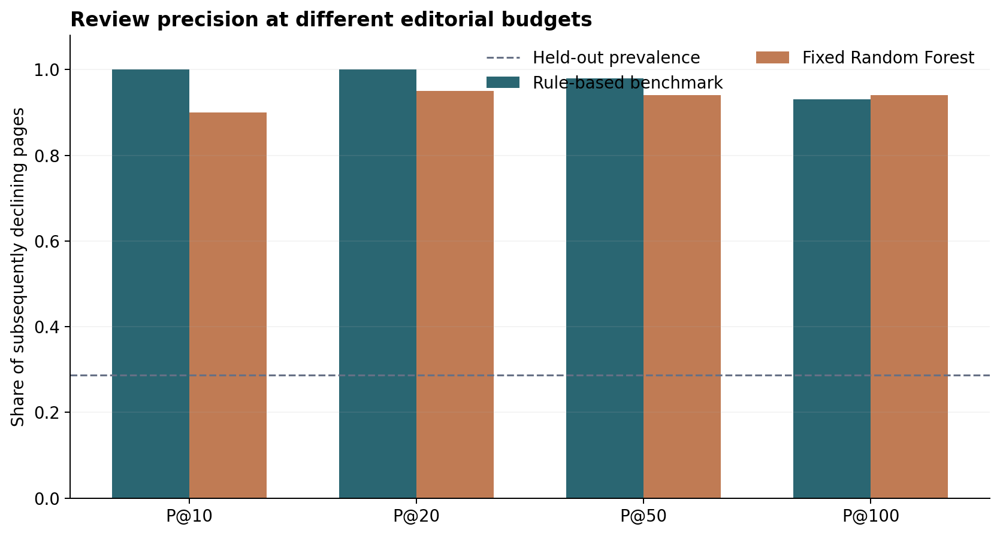
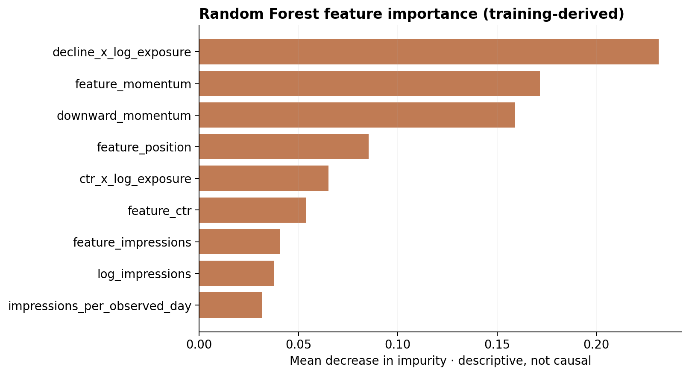

# Capstone Report — Prioritizing Content Reviews with Search Performance Signals

- **Author:** Pretom Areefin Pranto — Machine Learning Intern — FlyRank AI
- **Lane:** Lane 2 · Refresh / Content Opportunity Scoring
- **Repo:** https://github.com/pretom26/ml_internship_flyrankAI
- **Date:** 2026-10-21
- **Research paper:** `docs/index.html` (GitHub Pages); the verified live URL is recorded separately in `submission/paper_url.txt` at publication.
- **Results source:** `work/reports/capstone_results_public.json`, generated from the gated warehouse in the authorized Colab analysis.

## 1. Problem framing

An editorial team has limited time and must decide which existing content pages warrant a diagnostic review first. The **unit of analysis** is one pseudonymized client × content page, aggregated over April 2026, with an observed outcome in May 2026. The outputs are a **priority score**, a **ranked review queue**, a **reason code**, and an **editorial review action**. A reviewer should inspect the underlying page's tracking quality, indexing, search-demand changes, intent match, and content currency before making any revisions.

False positives waste scarce editorial review time and may induce unnecessary content changes; false negatives cause truly declining pages to receive attention later. Review itself is not a refresh treatment. A baseline allows users to inspect how recommendations are made, while the Random Forest tests whether interactions among observable prior-month signals improve evidence-based prioritization. **Success is defined as ranking subsequently declining pages high enough to be reviewed under a limited editorial budget, not proving any benefit from refreshes.**

## 2. Data safety

**Approved release:** FlyRank internship warehouse v20260703; gated monthly Parquet partitions of `fact_content_daily_performance` loaded through DuckDB's Hugging Face access inside authorized Google Colab. April 1–30, 2026 supplies features; May 1–31, 2026 supplies subsequent outcomes. The cohort includes **107,144 eligible observations across 47 client groups**; training uses 103,980 records from 37 clients and evaluation uses 3,164 records from 10 different clients. The observed client overlap is **0**.

Eligibility requires at least 100 April impressions and at least five days with GSC impression observations **in both months**. Exclusions include absent following-month records, inadequate coverage, low April exposure, or missing keys/labels. Duplicate client–page combinations cause an explicit error. A missing next-month row is **not** counted as zero impressions. Outcome-month coverage is used for **retrospective sample eligibility only** and is **not an input feature**; it means the measured cohort may not represent all pages encountered in production.

The model **does not use** client/content hashes, URLs, names, domains, titles, keywords, private queries, the outcome-period impressions or observed-day counts, the binary outcome, or starter-dataset label-derived columns such as `trend_direction` and `trend_pct`. Likewise, FlyRank's product-derived decision flags (such as `health_score` or `needs_ctr_fix`) are not used. IDs are held in memory solely for joining, validating unique page grain, and grouping the split. The exported JSON and figures contain **aggregate** evidence, not row-level private exports.

**Publication boundary:** this capstone exports only numerical summaries and figures; its private page-level ranking stays in the authorized analysis session. All other repository material, including historical notebook outputs, must follow the same data-use rules. The artifact-level privacy check is not a retrospective audit of the repository’s commit history.

## 3. Baseline

The transparent benchmark assigns a descending editorial priority based on **40%** capped log impressions, **35%** negative intra-April momentum, and **25%** click-through-rate shortfall relative to **training-client-only** position-tier peers. The exposure cap and peer CTR summaries are derived from training clients, not held-out labels. This rule does not use the following-month outcome. It is a fair comparator because it uses the same eligible held-out pages, feature window, target labels, and ranking metrics as the Random Forest.

**Observed baseline:** Precision@10 = 1.000; Precision@20 = 1.000; **Precision@50 = 0.980**; Precision@100 = 0.930; Average Precision = 0.609; ROC-AUC = 0.745. The baseline’s top-50 list contains **49 observed declines** and **1 false-positive priorities** under the research label.

## 4. Model / analysis

**Final model:** one fixed scikit-learn `RandomForestClassifier` with 140 trees, `max_depth=10`, `min_samples_leaf=35`, `max_features='sqrt'`, `n_jobs=-1`, and `random_state=42`. The exact settings were informed by earlier development; this final report does not include or claim new experimental model comparisons. A training-only preprocessing pipeline imputes numeric missing values, scales numeric features, and one-hot encodes the position tier. Training uses only the designated training clients.

**Exact model features (13):** `feature_impressions`, `feature_clicks`, `feature_ctr`, `feature_position`, `feature_observed_days`, `feature_momentum`, `log_impressions`, `log_clicks`, `impressions_per_observed_day`, `downward_momentum`, `decline_x_log_exposure`, `ctr_x_log_exposure`, `position_tier`. All derive from the **feature month**, including April's early-versus-late impression momentum and interactions with exposure. Raw early/late impression aggregates are used **only** to construct April momentum, not as additional unreviewed model columns.

**One-sentence target:** A page is labeled 1 when its May 2026 impressions per calendar day are **strictly more than 30% lower** than its April 2026 impressions per calendar day, conditional on the observation criteria. This is an observed next-month decline proxy, not an indication that a page should automatically be rewritten.

## 5. Evaluation

A fixed `GroupShuffleSplit(test_size=0.2, random_state=42)` holds out entire client groups; the resulting unequal client sizes create a 3.0% row-level holdout despite 20% of the **groups** being reserved. Three training-only grouped validation folds check consistency. The same 3,164 held-out rows and outcome labels are scored by both the rule and the Random Forest. The April-to-May label starts strictly after the feature window; future metrics and any transformed outcome are excluded from predictors. The held-out April–May group was previously examined during development, so these scores are **descriptive rather than a newly untouched confirmation test**.

**Base rate:** The positive outcome prevalence is **28.70%** (908 positives among 3,164 held-out page observations, rounded from aggregate reporting). The majority-class fraction is **71.30%**, which is not a ranking quality measure. Precision@K should therefore be read alongside the prevalence, lift, Average Precision, and ROC-AUC.

| Same historical held-out cohort | Rule benchmark | Random Forest |
|:--|--:|--:|
| Precision@10 | 1.000 | 0.900 |
| Precision@20 | 1.000 | 0.950 |
| **Precision@50** | **0.980** | **0.940** |
| Precision@100 | 0.930 | 0.940 |
| Average Precision | 0.609 | 0.678 |
| ROC-AUC | 0.745 | 0.831 |
| Lift@50 over 28.70% prevalence | 3.41× | 3.28× |

**Budgeted error analysis:** Among the top 50 recommendations, the rule prioritizes 49 positives and 1 negatives, while the Random Forest prioritizes 47 positives and 3 negatives. Both reach 93% Precision@100. These observations show why a higher global ROC-AUC does **not** guarantee a better 50-page queue. The top-K false positives require manual diagnosis; no public page records are disclosed.

**Descriptive paired client-bootstrap intervals (Random Forest − rule; 400 repetitions):** P@50 -0.040 [-0.100, +0.060]; Average Precision +0.069 [-0.011, +0.121]; ROC-AUC +0.086 [+0.009, +0.111]. The difference intervals for P@50 and Average Precision include zero, and only 10 held-out clients were available, so the intervals should not be over-interpreted as definitive statistical proof.

**Secondary time-window check:** May predictors → June outcomes for 6,637 observations across 9 client groups, using the **unchanged** model without refitting. P@50: rule 0.960 versus Random Forest 0.860; Average Precision: rule 0.602 versus Random Forest 0.633. The same client holdout is reused and May features are contemporaneous with the original training-label month for other clients, so this is a **robustness check**, not a clean prospective trial.

## 6. Interpretation

The main negative result matters: at a fixed budget of 50 human reviews, the **transparent rule is better** (98% versus 94%), even though Random Forest ranks more effectively across the full evaluation population (Average Precision 0.678 versus 0.609; ROC-AUC 0.831 versus 0.745). There is no universal winner; the choice depends on whether editors prioritize a small high-confidence queue or broader risk discovery.

The notebook's training-derived impurity feature-importance figure places **decline × log exposure**, **within-month momentum**, and **downward momentum** among the strongest contributors, followed by position and CTR-related signals. These variables are correlated transformations of observed search data; impurity importance is **not** a causal explanation and can split importance among related variables. This analysis does not show that changing any single predictor would change rankings or prevent a decline.





## 7. Recommendation

Use the **rule-based ranking as the initial operational queue** because it performs better at P@50 in both the historical comparison and secondary time-window check. Treat the Random Forest score as supporting diagnostic evidence rather than a trigger for a content refresh. An authorized editor can inspect the highest-ranked pages **within the private warehouse environment**; no page-specific recommendations are published publicly.

| Priority band | Pages | Evidence-guided human action |
|:--|--:|:--|
| 1–10 | 10 | Verify tracking, index coverage, demand patterns and content currency immediately; avoid automatic rewriting. |
| 11–25 | 15 | Review the next 15 after excluding measurement anomalies and seasonal effects. |
| 26–50 | 25 | Maintain a monitored watchlist and prioritize if new observations strengthen the concern. |

**Observed rule-ranked top-50 reasons:** `VISIBLE_SLOWDOWN`: 31, `LOW_EVIDENCE`: 19. **Evidence level:** `moderate`: 27, `limited`: 19, `higher-volume`: 4. In particular, 19 records with low evidence merit monitoring before invasive edits. The reason codes are review prompts—not validated diagnoses or a claim that a recommended edit improves organic visibility.

**Confidence and cost:** A top-50 positive rate does not imply certain intervention benefit or calibrated probability. Editorial effort should be proportional to exposure, measurement reliability, and the cost of a wrong call. Flagging a page for audit should not automatically prune, merge, or rewrite it.

## 8. Reproducibility

**Repository:** https://github.com/pretom26/ml_internship_flyrankAI. Main notebook: [`work/notebooks/capstone.ipynb`](https://github.com/pretom26/ml_internship_flyrankAI/blob/main/work/notebooks/capstone.ipynb). Numerical reference: [`work/reports/capstone_results_public.json`](https://github.com/pretom26/ml_internship_flyrankAI/blob/main/work/reports/capstone_results_public.json). Public paper: `docs/index.html` under GitHub Pages. This report is an additional required artifact at `work/capstone_report.md`.

**Exact Colab workflow (from a fresh repo checkout):**

```bash
git clone https://github.com/pretom26/ml_internship_flyrankAI.git
cd ml_internship_flyrankAI
# In Google Colab: File → Open notebook → GitHub; select
# work/notebooks/capstone.ipynb from this repository.
# In Colab Secrets, grant this notebook access to HF_TOKEN (read token).
# Runtime → Run all, then review generated reports and site artifacts.
```

The notebook's first setup cell runs:

```python
%pip -q install "duckdb>=1.4,<2" "pandas>=2.0" "numpy>=1.24" "scikit-learn>=1.3" "matplotlib>=3.7"
```

**Seeds:** Outer `GroupShuffleSplit` and Random Forest: `42`. Internal grouped validation split: `2026`. Paired client-bootstrap resampling: `2026` (400 replicates). The reported feature/construction logic and charts live inside the notebook, with no additional helper modules required. Queries need authorized access to the **gated** FlyRank warehouse; no raw training data or secret keys are committed or bundled. A repeat execution may be subject to remote release stability, environment changes, or deterministic tie ordering.

**Environment specification:**
  - `duckdb`: `1.5.6`
  - `pandas`: `2.2.3`
  - `numpy`: `2.1.3`
  - `scikit-learn`: `1.6.1`
  - `matplotlib`: `3.10.0`

**Generate publication materials:** the final notebook writes the report, HTML, four charts and aggregate JSON in one authorized Colab run. To regenerate only the eight-section Markdown report from the saved aggregate JSON, run `python work/generate_capstone_report.py` at the repository root. This operation never reads raw warehouse records.

**Verification:** a reproducible run verifies zero client overlap, equal evaluation cohorts, regenerated aggregate statistics and renderable figures. Run `python work/validate_release.py` at the repository root after copying the Colab outputs. Its checks compare the public metrics, report, HTML and chart paths; they cannot replace an actual authorized rerun of the gated data.

---

### Claims and data-use statement

This study measures later impressions decline among eligible pages; it does not test whether editing pages improves future search performance, recover any search engine’s ranking algorithm, or validate page-level interventions. The outcome base rate and adverse benchmark comparisons are shown alongside the favorable ML results. Published materials consist of aggregate statistics and figures; authorized raw records and private ranking queues remain outside the repository. The direct publication URL belongs in `submission/paper_url.txt` only after the live website has been verified.
